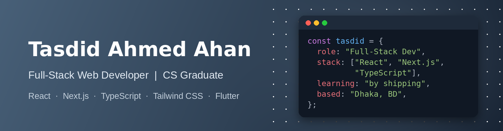

  

# Hi, I'm Tasdid 👋

**Full-Stack Web Developer | CS Graduate | Open to Internships**

## 💫 About Me

I'm a Computer Science graduate from Independent University, Bangladesh (IUB), building full-stack web apps with **React, Next.js and TypeScript**. I learn by shipping real projects: a market price tracker, a workout tracker and a developer-stack explorer. AI tools are part of my workflow, and I use them to build faster while working to understand every piece I ship.

Outside the web, I've built Flutter apps and a deep-learning project for waste classification. I'm looking for an internship where I can contribute to real products and grow alongside experienced engineers.

## 🔭 What I'm Up To

- 🚀 Building full-stack apps with Next.js, TypeScript and authentication
- 🌱 Exploring Supabase and backend fundamentals
- 📚 Strengthening my TypeScript and backend fundamentals
- 💼 Looking for web development internship opportunities

## 🛠️ Featured Projects

| Project | What it is | Stack | Links |
| --- | --- | --- | --- |
| **BazarDor** | Full-stack web app to explore and track everyday market prices | Next.js, TypeScript | [Live](https://bazar-dor-price-tracker.vercel.app/) · [Code](https://github.com/tasdid-ahmed/bazar-dor-price-tracker) |
| **FitLog** | Workout library and daily plan tracker where you log your sets | Next.js, TypeScript, Tailwind CSS, DaisyUI | [Live](https://fitlog-workout-tracker-beta.vercel.app) · [Code](https://github.com/tasdid-ahmed/fitlog-workout-tracker) |
| **Dev Stack** | Browse developer technologies and build a personalized tech stack | React, TypeScript, Vite, Tailwind CSS | [Live](https://devstack-by-tasdidahmed.netlify.app/) · [Code](https://github.com/tasdid-ahmed/dev-stack) |

## 💻 Tech Stack

**Languages**

<table>
  <tr>
    <td align="center" width="100"> JavaScript</td>
    <td align="center" width="100"> TypeScript</td>
    <td align="center" width="100"> Dart</td>
    <td align="center" width="100"> Python</td>
  </tr>
  <tr>
    <td align="center" width="100"> Java</td>
    <td align="center" width="100"> HTML</td>
    <td align="center" width="100"> CSS</td>
  </tr>
</table>

**Web**

<table>
  <tr>
    <td align="center" width="100"> React</td>
    <td align="center" width="100"> Next.js</td>
    <td align="center" width="100"> Tailwind CSS</td>
    <td align="center" width="100"> Vite</td>
  </tr>
</table>

**Mobile, Data & Backend**

<table>
  <tr>
    <td align="center" width="100"> Flutter</td>
    <td align="center" width="100"> Firebase</td>
    <td align="center" width="100"> MySQL</td>
  </tr>
</table>

**Tools & Deployment**

<table>
  <tr>
    <td align="center" width="100"> Git</td>
    <td align="center" width="100"> GitHub</td>
    <td align="center" width="100"> VS Code</td>
  </tr>
  <tr>
    <td align="center" width="100"> Vercel</td>
    <td align="center" width="100"> Netlify</td>
  </tr>
</table>

**Familiar with** (used with AI assistance, still learning)

<table>
  <tr>
    <td align="center" width="100"> Supabase</td>
  </tr>
</table>

## 📫 Get in Touch

- **Email:** [tasdidahmed.official@gmail.com](mailto:tasdidahmed.official@gmail.com)
- **Location:** Dhaka, Bangladesh
